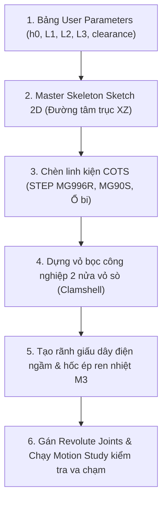

# Quy trình Thiết kế Cơ khí CAD (Autodesk Fusion 360) & Tự động hoá MCP

> Tài liệu hướng dẫn chuẩn quy trình thiết kế cánh tay robot công nghiệp 5-DOF (KUKA/ABB style) cho nhóm đồ án.

---

## 1. Phương pháp luận: Top-Down Skeleton Design

Quy tắc bất di bất dịch khi thiết kế cơ cấu robot nhiều bậc tự do: **Tuyệt đối không vẽ từng chi tiết rời rạc**. Mọi khâu phải liên kết chặt chẽ qua một khung xương tổng thể (**Master Skeleton**).

---

## 2. Thiết lập Bảng tham số (User Parameters)
Trước khi vẽ bất kỳ nét nào, vào `Modify -> Change Parameters` trong Fusion 360 và nhập:

| Tên biến | Đơn vị | Giá trị | Ý nghĩa |
|---|---|---|---|
| `h0` | mm | `80` | Chiều cao từ đáy bàn đến trục khớp Vai J2 |
| `L1` | mm | `110` | Chiều dài link Vai (J2 -> J3) |
| `L2` | mm | `100` | Chiều dài link Cẳng tay (J3 -> J4) |
| `L3` | mm | `55` | Chiều dài Cổ tay đến tâm ngón kẹp |
| `wall_thick` | mm | `2.8` | Độ dày vỏ nhựa in 3D |
| `clearance` | mm | `0.35` | Khe hở lắp ghép in FDM |
| `bearing_608_od` | mm | `22.0` | Đường kính ngoài vòng bi 608ZZ |
| `bearing_625_od` | mm | `16.0` | Đường kính ngoài vòng bi 625ZZ |

---

## 3. Khởi chạy Autodesk Fusion MCP Server
Add-in `AutodeskFusionMCP` đã được cài đặt vào thư mục:
`%APPDATA%\Autodesk\Autodesk Fusion 360\API\AddIns\AutodeskFusionMCP`

### Cách kích hoạt trong Fusion 360:
1. Nhấn tổ hợp phím **`Shift + S`** (hoặc vào menu `Utilities` -> `ADD-INS` -> `Scripts and Add-Ins`).
2. Chọn tab **`Add-Ins`**.
3. Tìm và chọn **`AutodeskFusionMCP`**.
4. Tích chọn ô **`Run on Startup`** (để tự động chạy mỗi khi mở Fusion).
5. Nhấn nút **`Run`**.
6. Server sẽ lắng nghe tại: `http://127.0.0.1:8766/mcp`.

---

## 4. Quy chuẩn In 3D (DFM Guidelines)
- **Vật liệu**: Nhựa PLA hoặc PETG (khuyến nghị PETG cho các chi tiết chịu lực như khâu vai).
- **Thiết lập Slicer**:
  - Số lớp thành (Perimeters / Wall loops): $\ge 4$ lớp.
  - Mật độ Infill: $35\% - 40\%$ (dạng Gyroid hoặc Grid).
  - Chiều cao lớp in: $0.2\text{ mm}$.
- **Đai ốc cấy nhiệt (Heat-set inserts)**: Dùng mỏ hàn nhiệt $250^\circ\text{C}$ dí nhẹ đai ốc ren thau M3 vào lỗ $\varnothing 4.2\text{ mm}$ đã in sẵn.
