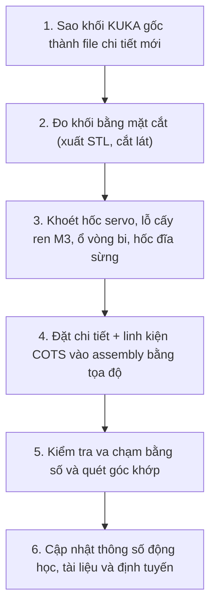

# Quy trình Thiết kế Cơ khí CAD (SolidWorks) & Tự động hoá MCP

> Quy trình thiết kế cánh tay robot 5-DOF dáng KUKA KR 3 R540 (tỉ lệ 0.49) của nhóm đồ án.

---

## 1. Phương pháp: dùng thân KUKA gốc làm hình dáng, khoét chỗ cho phần cứng

Mỗi khâu của robot lấy trực tiếp một khối của mô hình KUKA KR 3 R540 tỉ lệ $0.49$ (`cad/parts/KR3 R540.SLDPRT` và các file `bergE5F4F25F1bc4[*].SLDPRT`), giữ nguyên dáng ngoài và hệ tọa độ, rồi chỉ khoét những chỗ cần cho servo, đĩa sừng, vòng bi, ren cấy nhiệt và mạch điện.

Vì mọi khối KUKA dùng chung một hệ tọa độ (mặt bàn tại $z = 0$, trục $J_1$ là trục $Z$), các chi tiết đế, turret và cánh tay đặt vào assembly với cùng một phép biến đổi, không cần căn chỉnh.

---

## 2. Bảng tham số hình học

| Tên biến | Đơn vị | Giá trị | Ý nghĩa |
|---|---|---|---|
| `h0` | mm | `169.05` | Chiều cao từ đáy bàn đến trục khớp Vai J2 |
| `a1` | mm | `9.8` | Độ lệch trục vai J2 về phía trước trục đế J1 |
| `L1` | mm | `127.4` | Chiều dài link Vai (J2 -> J3) |
| `L2` | mm | `127.8` | Chiều dài link Cẳng tay (J3 -> J4) |
| `L3` | mm | `86.8` | Chiều dài Cổ tay J4 đến tâm gắp (rãnh chữ V của ngón kẹp) |
| `clearance` | mm | `0.3` | Khe hở mỗi bên quanh thân servo |
| `bearing_698_od` | mm | `19.0` | Đường kính ngoài vòng bi 698ZZ (lỗ CAD $\varnothing 19.1 \times 6.2$) |

---

## 3. SolidWorks MCP

Mọi thao tác CAD đi qua các công cụ SolidWorks MCP (xem `docs/huong-dan-solidworks-mcp.md`). Tham số truyền cho công cụ tính bằng **mét**; trao đổi và ghi tài liệu bằng **milimét**.

Sau mỗi nhóm feature: kiểm tra số khối (`analyze_model` kiểu `bodies`), thể tích thay đổi đúng dự tính, rồi `save_document`.

---

## 4. Kiểm tra va chạm

1. Mở assembly, xuất STL (mỗi component một file) vào một thư mục tạm.
2. Chạy `python cad/tools/check_interference_stl.py <thư_mục>`.
3. Chạy thêm `Evaluate -> Interference Detection` trong SolidWorks để đối chiếu.

Trục then hoa của servo lún vào đĩa sừng là lắp chặt có chủ ý, không phải lỗi. Công cụ lưới báo nhầm một vài điểm ở mặt cong (servo $J_3$ với `03_UpperArmKuka`) và không thấy chỗ lún dưới khoảng $0.02\text{ mm}$, nên kết quả của SolidWorks là kết quả chốt.

---

## 5. Quy chuẩn In 3D (DFM)
- **Vật liệu**: PETG.
- **Thiết lập Slicer**:
  - Số lớp thành (Perimeters / Wall loops): $\ge 4$ lớp.
  - Mật độ Infill: $15\% - 20\%$ cho các khối thân KUKA lớn (đế, turret, cánh tay); $35\% - 40\%$ cho chi tiết nhỏ chịu lực.
  - Chiều cao lớp in: $0.2\text{ mm}$.
- **Support**: các khối thân KUKA có mặt cong tự do và trần phẳng nên cần support; đế in úp ngược.
- **Ren cấy nhiệt M3**: lỗ $\varnothing 4.2 \times 5.5\text{ mm}$ có đáy, ép bằng mỏ hàn khoảng $250^\circ\text{C}$.
- **Tai servo MG996R**: mỗi tai có một gân tăng cứng ở mặt phía trục ra; mặt tựa tai phải có rãnh né gân rộng $2.0$, sâu $2.0\text{ mm}$.
