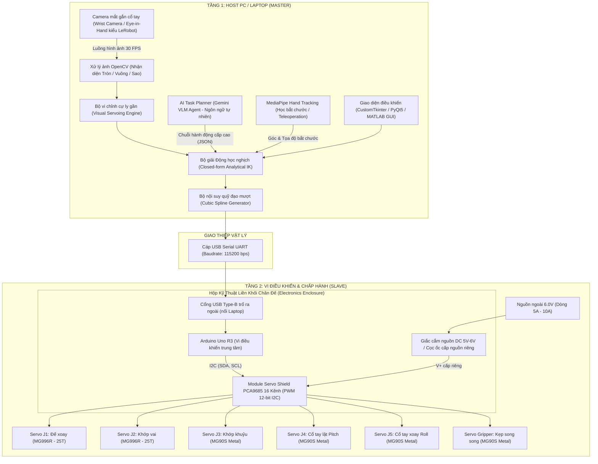

# KẾ HOẠCH ĐIỀU KHIỂN & HỆ THỐNG TRÍ TUỆ NHÂN TẠO CHO ROBOT KUKA KR 3 (5-DOF + GRIPPER)
**Dự án:** Cánh tay robot công nghiệp mô phỏng KUKA KR 3 R540  
**Đơn vị:** Đồ án thiết kế và điều khiển cánh tay robot – Trường Đại học Công nghệ (UET - VNU)  
**Tác giả:** Nhóm nghiên cứu đồ án UET & Antigravity Copilot  
**Ngày cập nhật thiết kế:** 27/09/2026 (Tích hợp chuẩn Hugging Face LeRobot & Hộp mạch Arduino chân đế)

---

## I. TỔNG QUAN KIẾN TRÚC HỆ THỐNG (SYSTEM OVERVIEW)

Hệ thống điều khiển robot được thiết kế theo mô hình **Master – Slave** 2 tầng chuẩn công nghiệp, đón đầu xu hướng **Embodied AI & LeRobot**:

---

## II. CHI TIẾT PHẦN CỨNG & HỘP MẠCH CHÂN ĐẾ (ELECTRONICS ENCLOSURE)

### 1. Hộp chứa mạch liền khối phía sau Chân đế (`01_Base_Pedestal.SLDPRT`):
* **Kích thước bao khoang hộp:** Dài $75.0\text{ mm} \times$ Rộng $60.0\text{ mm} \times$ Cao $32.0\text{ mm}$.
* **4 trụ bắt ốc M3 cho Arduino Uno R3:**
  * Khoảng cách tâm lỗ theo chiều ngang: **$50.8\text{ mm}$**.
  * Khoảng cách tâm lỗ theo chiều dọc: **$27.9\text{ mm}$** (với 2 lỗ đối xứng) và $15.2\text{ mm}$ (với lỗ lệch mép).
  * Trụ đùn cao $4.0\text{ mm}$, đường kính ngoài $\varnothing 6.0\text{ mm}$, lỗ mồi $\varnothing 2.8\text{ mm}$ để siết trực tiếp vít M3 (hoặc cấy ren đồng M3).
* **Cửa sổ trổ cổng USB Type-B:**
  * Kích thước: Rộng **$13.0\text{ mm}$** $\times$ Cao **$12.0\text{ mm}$**, cách mặt sàn $3.0\text{ mm}$.
* **Cửa sổ giắc nguồn DC / cọc ốc:**
  * Cắt khe tròn $\varnothing 10.0\text{ mm}$ cho giắc DC $5.5 \times 2.1\text{ mm}$ hoặc khe chữ nhật $12.0 \times 10.0\text{ mm}$ để luồn dây nguồn 6V vào cọc ốc Shield.
* **Lỗ luồn dây ngầm:**
  * Rãnh khoét kích thước $15.0 \times 8.0\text{ mm}$ thông từ khoang hộp mạch đi thẳng vào tim trụ xoay $\varnothing 72\text{ mm}$ của khớp $J_1$ để toàn bộ bó dây servo đi ngầm trong thân dầm, không lộ dây ra ngoài.
* **Nắp đậy bảo vệ (Enclosure Lid):**
  * Nắp phẳng mỏng $2.0\text{ mm}$, bắt 4 ốc chìm M3 vào 4 góc hộp, có khe thoát khí tản nhiệt cho chip PCA9685.

### 2. Phân bổ kênh PWM trên Shield PCA9685:
| Kênh PWM | Tên khớp | Loại động cơ | Góc giới hạn | Chức năng chuyển động |
| :---: | :---: | :---: | :---: | :--- |
| **Kênh 0** | **$J_1$** | MG996R (25T) | $-90^\circ \to +90^\circ$ | Xoay mâm đế quanh trục thẳng đứng $Z_0$ |
| **Kênh 1** | **$J_2$** | MG996R (25T) | $-30^\circ \to +90^\circ$ | Nâng/hạ khớp vai chính quanh trục ngang $Y_1$ |
| **Kênh 2** | **$J_3$** | MG90S Metal | $-110^\circ \to +10^\circ$ | Gập/duỗi khớp khuỷu tay quanh trục ngang $Y_2$ |
| **Kênh 3** | **$J_4$** | MG90S Metal | $-90^\circ \to +90^\circ$ | Gập lật cổ tay (Wrist Pitch) quanh trục ngang $Y_3$ |
| **Kênh 4** | **$J_5$** | MG90S Metal | $-90^\circ \to +90^\circ$ | Xoay tròn cổ tay (Wrist Roll) quanh trục dọc $Z_4$ |
| **Kênh 5** | **Gripper** | MG90S Metal | $0^\circ \to 60^\circ$ | Đóng/mở 2 ngón kẹp song song |

---

## III. THUẬT TOÁN ĐỘNG HỌC & LẬP QUỸ ĐẠO (KINEMATICS & TRAJECTORY)

### 1. Các thông số hình học bất biến:
* Chiều cao trục vai: $h_0 = 80.0\text{ mm}$
* Chiều dài cánh tay Link 1: $L_1 = 110.0\text{ mm}$
* Chiều dài cẳng tay Link 2: $L_2 = 100.0\text{ mm}$
* Chiều dài cụm kẹp Link 3: $L_3 = 55.0\text{ mm}$

### 2. Động học nghịch giải tích hình học (Closed-Form Analytical IK):
Với vị trí mục tiêu $(X, Y, Z)$ và góc chúc mong muốn của đầu kẹp $\phi$:
1. **Góc xoay đế $\theta_1$:**
   $$\theta_1 = \text{atan2}(Y, X)$$
2. **Tọa độ tâm cổ tay $(r_w, z_w)$:**
   $$r = \sqrt{X^2 + Y^2}$$
   $$r_w = r - L_3 \cos(\phi)$$
   $$z_w = Z - h_0 - L_3 \sin(\phi)$$
3. **Độ dài đường chéo nối từ vai đến tâm cổ tay:**
   $$D = \sqrt{r_w^2 + z_w^2}$$
4. **Góc khuỷu tay $\theta_3$ (Định lý hàm số Cosin):**
   $$\cos(\alpha_3) = \frac{L_1^2 + L_2^2 - D^2}{2 L_1 L_2} \implies \theta_3 = \alpha_3 - 180^\circ$$
5. **Góc vai $\theta_2$:**
   $$\beta_1 = \text{atan2}(z_w, r_w)$$
   $$\cos(\beta_2) = \frac{L_1^2 + D^2 - L_2^2}{2 L_1 D} \implies \theta_2 = \beta_1 + \beta_2$$
6. **Góc cổ tay gập $\theta_4$:**
   $$\theta_4 = \phi - (\theta_2 + \theta_3)$$

*(Thời gian tính toán trên Python/MATLAB: **$< 0.05\text{ ms}$**, không bao giờ bị lặp số hay kẹt điểm kỳ dị).*

### 3. Lập quỹ đạo mượt (Cubic Polynomial Trajectory Interpolation):
Tránh giật servo bằng cách nội suy góc khớp từ điểm bắt đầu $q_0$ đến điểm kết thúc $q_f$ trong thời gian $T$:
$$q(t) = q_0 + \frac{3(q_f - q_0)}{T^2} t^2 - \frac{2(q_f - q_0)}{T^3} t^3$$

---

## IV. THỊ GIÁC MÁY TÍNH GẮN CỔ TAY (EYE-IN-HAND WRIST CAMERA & VISUAL SERVOING)

### 1. Bố trí Camera kiểu Hugging Face LeRobot:
* **Vị trí gắn:** Module Camera USB mini (trọng lượng siêu nhẹ $\approx 8\text{g}$) được gắn nghiêng một góc **$35^\circ - 45^\circ$** ngay phía trên khớp cổ tay, hướng mắt nhìn chúc xuống đúng khoảng không gian giữa 2 ngón kẹp.
* **Cơ chế gắp thả 2 giai đoạn (Two-Stage Pick & Place Pipeline):**
  * **Giai đoạn 1 (Search - Quét toàn cảnh từ trên cao):**
    Robot nâng cánh tay lên vị trí Home ($Z \approx 200\text{ mm}$), camera quét tìm vị trí sơ bộ $(X_0, Y_0)$ của các khối hình (tròn, vuông, ngôi sao) trong vùng làm việc.
  * **Giai đoạn 2 (Visual Servoing - Vi chỉnh cự ly gần):**
    Robot hạ cánh tay xuống cách vật thể $6 - 8\text{ cm}$. Lúc này vật thể nằm trọn trong khung hình camera cổ tay ở độ phân giải cực cao. Thuật toán tính toán sai lệch pixel $(\Delta u, \Delta v)$ giữa tâm kẹp và tâm vật thể:
    $$\Delta X = k_x \cdot \Delta u, \quad \Delta Y = k_y \cdot \Delta v$$
    Robot vi chỉnh tọa độ $(X, Y)$ để tâm 2 ngón kẹp căn thẳng tắp với vật thể, đồng thời xoay trục $J_5$ trùng với góc xoay của vật $\to$ hạ xuống kẹp chặt.
  * **Giai đoạn 3 (Thả vào lỗ):**
    Robot mang vật sang khay chứa lỗ, camera cổ tay nhìn trực diện mép lỗ, vi chỉnh thẳng tâm và nhả kẹp thả vật rơi vừa khít vào lỗ.

---

## V. HỌC BẮT CHƯỚC & AI AGENT (IMITATION LEARNING & VLM TASK PLANNER)

### 1. Điều khiển từ xa & Học bắt chước (Google MediaPipe Hand Tracking):
* Camera laptop theo dõi bàn tay người (60 FPS):
  * Cổ tay người di chuyển trong không gian $\to$ Robot KUKA di chuyển bám đuổi theo tọa độ $(X, Y, Z)$.
  * Ngón cái và ngón trỏ chụm lại ($< 35\text{ pixels}$) $\to$ Gripper kẹp; mở ra $\to$ Gripper mở.
* **Chế độ Record & Replay:** Ghi lại chuỗi quỹ đạo người dạy gắp thả $\mathcal{D} = \{ (X_t, Y_t, Z_t, \text{Grip}_t) \}_{t=1}^N \to$ Robot tự động làm mượt và phát lại thành thạo.

### 2. AI Task Planner (Gemini VLM Agent):
* Người dùng nói hoặc gõ: *"Gắp khối vuông màu đỏ bỏ vào lỗ hình vuông bên trái!"*
* VLM Agent nhìn ảnh hiện tại từ camera, phân tích vị trí và sinh chuỗi hành động JSON (`APPROACH -> PICK -> LIFT -> TRANSFER -> PLACE -> RELEASE`).
* Python Dispatcher điều khiển IK và gửi lệnh Serial xuống Arduino Uno + Shield PCA9685.

---

## VI. LỘ TRÌNH 5 GIAI ĐOẠN HOÀN THIỆN DỰ ÁN

1. **Giai đoạn 1 (Cơ khí & Nền tảng MATLAB):** Hoàn thiện CAD chân đế, cổ tay, bàn kẹp; in 3D; chạy thử nghiệm mô hình động học và điều khiển bằng MATLAB GUI (`matlab/kuka_gui_control.m`).
2. **Giai đoạn 2 (Python Kinematics & Serial Bridge):** Chuyển thuật toán IK và nội suy Cubic Spline sang Python, điều khiển robot qua giao diện CustomTkinter.
3. **Giai đoạn 3 (Eye-in-Hand Vision):** Gắn camera USB mini lên cổ tay, lập trình thuật toán nhận diện hình học (Tròn, Vuông, Sao) và Visual Servoing 2 giai đoạn gắp thả tự động.
4. **Giai đoạn 4 (MediaPipe Teleoperation & Imitation Learning):** Bắt cử động bàn tay người điều khiển robot thời gian thực và chế độ Record & Replay.
5. **Giai đoạn 5 (AI Agent VLM & Thuyết minh UET):** Tích hợp Gemini VLM điều khiển bằng giọng nói tiếng Việt, đóng gói video demo và xuất bản báo cáo thuyết minh PDF hoàn chỉnh.
