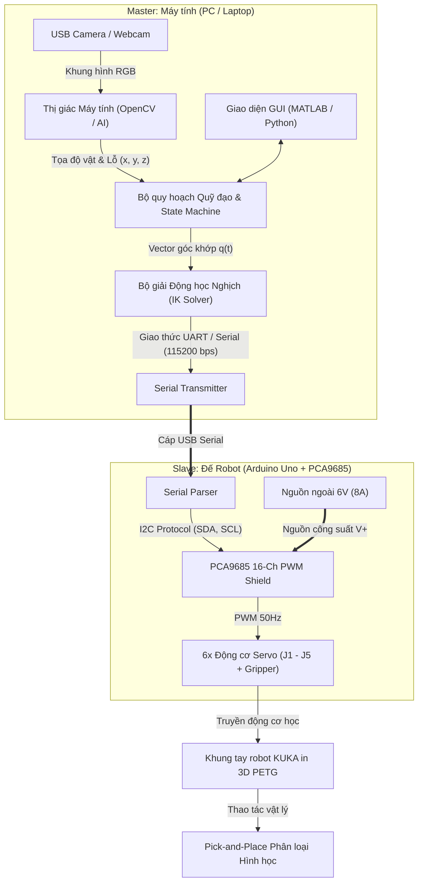

# Mục tiêu & Yêu cầu Kỹ thuật Đồ án: Cánh tay Robot Công nghiệp 5-DOF UET

> **Đồ án môn học:** Các cơ cấu chấp hành robot — Khoa Cơ điện tử, Trường Đại học Công nghệ, ĐHQGHN (VNU-UET).  
> **Dự án:** Thiết kế, Chế tạo và Điều khiển Cánh tay Robot 5-DOF kèm Tay gắp Song song (KUKA KR 3 R540 Scale 0.49).  
> **Văn bản này là:** Kim chỉ nam mục tiêu tối thượng (Definition of Done) định hướng toàn bộ hoạt động thiết kế cơ khí, mạch điện tử, phần mềm điều khiển và báo cáo tốt nghiệp môn học.

---

## 1. Tổng quan Dự án & Nhiệm vụ Vận hành (Mission & Operational Task)

### 1.1. Nhiệm vụ Cốt lõi (Core Task)
- **Pick-and-Place phân loại hình học:** Robot thực hiện chu trình tự động gắp các khối hình học đa dạng (hình **tròn**, **vuông**, **ngôi sao**...) từ vùng cấp phôi và thả chính xác vào các lỗ định hình tương ứng trên bảng phân loại đích.
- **Dung sai khớp hình (Fit & Clearance):** Độ chính xác định vị đầu cuối $\le \pm 3\text{ mm}$ để vật lọt trơn tru vào lỗ (khe hở thiết kế lỗ lớn hơn vật từ $3 - 5\text{ mm}$).
- **Chu kỳ gắp–thả:** Đạt mục tiêu $\le 15\text{ s}$ cho mỗi chu trình hoàn chỉnh (Tiếp cận $\rightarrow$ Gắp $\rightarrow$ Nhấc $\rightarrow$ Di chuyển $\rightarrow$ Thả $\rightarrow$ Về vị trí chờ).

### 1.2. Ràng buộc Tải trọng & Không gian Hoạt động (Payload & Workspace)
- **Tải trọng danh định:** Khối lượng vật gắp tối thiểu $50\text{ g}$ (ổn định ở tư thế vươn xa nhất mà không trôi khớp hay sụt tốc).
- **Tầm với làm việc:** Bán kính thao tác tối thiểu $R_{\text{reach}} \ge 200\text{ mm}$ (thiết kế hình học KUKA scale 0.49 đạt tầm với cực đại thực tế $\approx 282 - 330\text{ mm}$, bao phủ toàn bộ vùng gắp và vùng thả trên mặt bàn).

---

## 2. Kiến trúc Cơ điện & Cơ cấu Chấp hành (Mechanical & Electrical Architecture)

Hệ thống được thiết kế theo cấu trúc công nghiệp 5-DOF dạng nối tiếp phỏng theo robot **KUKA KR 3 R540** (tỷ lệ thu nhỏ $\approx 0.49$), tối ưu hóa cho công nghệ in 3D FDM.

```
                  [J4: MG90S - Pitch] ─── [J5: MG90S - Roll] ─── [Gripper: MG90S]
                           │
             [J3: MG996R + 698ZZ - Elbow]
                           │
         [J2: DS3225 25kg + 698ZZ - Shoulder]
                           │
             [J1: MG996R - Turret Yaw]
                           │
          [Base Frame + Arduino + PCA9685]
```

### 2.1. Phân bổ Động cơ & Khớp chấp hành

| Khớp | Chức năng chuyển động | Động cơ lựa chọn | Giải pháp truyền động & Chịu tải |
|---|---|---|---|
| **$J_1$ (Base)** | Xoay đế (Yaw) $\pm 90^\circ$ | TowerPro MG996R ($11\text{ kg}\cdot\text{cm}$) | Treo ngược dưới trần đế `01_Base_Kuka`; truyền lực qua đĩa kim loại 25T; vành chân $\varnothing 92\text{ mm}$ + ngõng trục $\varnothing 49\text{ mm}$ đóng vai trò ổ trượt chịu moment lật. |
| **$J_2$ (Shoulder)** | Khớp vai (Pitch) $-45^\circ \to +165^\circ$ | Servo số 25 kg·cm $180^\circ$ (DS3225SG) | Đĩa sừng kim loại 25T bắt 4 ốc M3; tai đối diện đỡ bằng vòng bi rãnh sâu **698ZZ** ($\varnothing 19 \times \varnothing 8 \times 6\text{ mm}$) và chốt bu-lông M8 chống xoắn lệch. |
| **$J_3$ (Elbow)** | Khớp khuỷu (Pitch) $-60^\circ \to +120^\circ$ | TowerPro MG996R ($11\text{ kg}\cdot\text{cm}$) | Khối khuỷu KUKA kết hợp đĩa kim loại 25T và vòng bi đỡ phụ 698ZZ / trục M8. |
| **$J_4$ (Wrist Pitch)** | Gập cổ tay $\pm 90^\circ$ | Micro Servo MG90S ($2.2\text{ kg}\cdot\text{cm}$) | Trục servo kết hợp sừng 2 nhánh MG90S; chốt xoay đối xứng $\varnothing 8.3\text{ mm}$. |
| **$J_5$ (Wrist Roll)** | Xoay cổ tay $\pm 90^\circ$ | Micro Servo MG90S ($2.2\text{ kg}\cdot\text{cm}$) | Bố trí dọc trục cẳng tay, định vị trực tiếp trục gắp của End-Effector. |
| **Gripper** | Tay kẹp song song | Micro Servo MG90S ($2.2\text{ kg}\cdot\text{cm}$) | Cơ cấu thanh truyền/bánh răng thanh răng kẹp song song, độ mở ngàm $\ge 50\text{ mm}$. |

### 2.2. Điện tử Điều khiển & Cung cấp Nguồn
- **Bộ điều khiển trung tâm (MCU):** Arduino Uno R3 cắm chồng board mở rộng **PCA9685 16-Channel 12-bit PWM I2C Shield**, tích hợp gọn gàng trong khay đế `01_Base_Tray`.
- **Phân tách nguồn động lực:**
  - Nguồn Logic ($5\text{V}$): Cấp từ cổng USB máy tính hoặc chip hạ áp cho Arduino Uno.
  - Nguồn Động lực ($6\text{V}$, dòng định mức $\ge 5 - 8\text{ A}$): Cấp độc lập vào terminal $V+$ của shield PCA9685; tuyệt đối không lấy nguồn servo từ chân $5\text{V}$ của Arduino nhằm triệt tiêu hiện tượng sụt áp gây reset MCU khi các servo khởi động đồng thời.

### 2.3. Tiêu chuẩn Thiết kế Chế tạo DFM (PETG & Fasteners)
- **Vật liệu in 3D:** Nhựa kỹ thuật **PETG** cho toàn bộ kết cấu chịu lực (chịu nhiệt $\ge 60^\circ\text{C}$ chống dão nhiệt từ thân servo kim loại, bền va đập và chịu mỏi tốt hơn PLA).
- **Quy tắc Zero-Support / DFM:** Tất cả góc vát thoát vật liệu đều $\ge 45^\circ$ so với phương nằm ngang để giảm thiểu support; các hốc bắt dây điện được làm vát dốc tự nâng.
- **Liên kết kim khí (Heat-set Inserts):** Sử dụng cấy ren nhiệt đồng M3 tiêu chuẩn ($\varnothing 4.2\text{ mm} \times 5.0 - 5.5\text{ mm}$ có đáy bịt) cho toàn bộ các vị trí bắt ốc tháo lắp nhiều lần (tai servo, nắp đậy, bắt cụm lắp).

---

## 3. Mô hình Động học & Phần mềm Điều khiển (Kinematics & Control Stack)

### 3.1. Mô hình Động học D-H (Denavit-Hartenberg)
Cánh tay robot 5-DOF tuân theo bảng thông số D-H tiêu chuẩn (với $h_0 = 169.05\text{ mm}$, $a_1 = 9.8\text{ mm}$, $L_1 = 127.4\text{ mm}$, $L_2 = 132.3\text{ mm}$, $L_3 \approx 60\text{ mm}$):
- **Động học thuận (Forward Kinematics - FK):** Tính toán tọa độ và hướng của kẹp gắp từ vector góc khớp $\mathbf{q} = [\theta_1, \theta_2, \theta_3, \theta_4, \theta_5]^T$ thông qua chuỗi ma trận biến đổi thuần nhất $T_0^5 = A_1 A_2 A_3 A_4 A_5$.
- **Động học nghịch (Inverse Kinematics - IK):** Giải bài toán vị trí và góc hướng $(x, y, z, \text{pitch}, \text{roll})$ bằng phương pháp giải tích kết hợp hình học phân rã (Decoupled Geometric IK) đảm bảo tính thời gian thực cho MCU/PC.
- **Quy hoạch quỹ đạo (Trajectory Planning):** Nội suy đa thức bậc 3 hoặc bậc 5 (Cubic/Quintic Spline) trong không gian khớp để tránh giật đột ngột gia tốc, bảo vệ nhông hộp số servo.

### 3.2. Sơ đồ Luồng Điều khiển Toàn diện (System Workflow)



---

## 4. Tính năng Nâng cao / Tiêu chí Đánh giá Điểm cao (Bonus Engineering Capabilities)

Đồ án chú trọng chiều sâu kỹ thuật, khả năng tích hợp công nghệ và tính sáng tạo kỹ thuật:

### 4.1. Thị giác Máy tính Tự động (Vision-Based Pick & Place)
- **Nhận diện hình khối:** Sử dụng Camera USB kết hợp thuật toán xử lý ảnh OpenCV / mô hình AI để nhận diện biên dạng hình tròn, hình vuông, ngôi sao và tâm trọng lượng của phôi.
- **Xác định vị trí lỗ thả:** Tự động phát hiện vị trí và hướng các ô cờ trên bảng ghép đích.
- **Chuyển đổi tọa độ (Hand-Eye / Camera Calibration):** Thiết lập ma trận biến đổi từ tọa độ ảnh ($u, v$) sang tọa độ thực tế của không gian cánh tay ($x, y, z$).

### 4.2. Chế độ Dạy học / Ghi nhớ Chuyển động (Imitation Learning / Teaching Mode)
- **Record & Replay:** Người dùng điều khiển trực tiếp từng khớp (qua GUI, bàn phím, núm xoay potentiometer hoặc dắt tay hỗ trợ) để robot thực hiện mẫu một chu trình gắp thả chuẩn.
- **Tái hiện mượt mà:** Bộ điều khiển lưu lại chuỗi trạng thái góc khớp theo thời gian thực và nội suy phát lại tự động chính xác với tốc độ tùy biến.

---

## 5. Tổ chức Nhân sự, Ngân sách & Phân công (Team Structure & Budget)

### 5.1. Ngân sách & Định mức Dự án
- **Quy mô nhóm:** 03 sinh viên ngành Cơ điện tử / Tự động hóa - UET.
- **Kinh phí khuyến nghị:** Khoảng **500.000 VNĐ / sinh viên** (Tổng ngân sách nhóm: $\approx 1.500.000\text{ VNĐ}$).
- **Tiêu chí linh kiện:** Tối ưu hóa chi phí với linh kiện phổ thông sẵn có tại thị trường Việt Nam (Arduino Uno, PCA9685, servo MG996R, DS3225, MG90S, nhựa in PETG).

### 5.2. Bảng Phân công Trách nhiệm Chi tiết

| Thành viên | Phụ trách chính | Nhiệm vụ cụ thể | Sản phẩm bàn giao chính |
|---|---|---|---|
| **Thành viên 1** | **Cơ khí & Chế tạo CAD/DFM** | - Thiết kế 3D hoàn thiện cụm đế, turret, cánh tay, cổ tay và tay gắp theo chuẩn KUKA trên SolidWorks.<br>- Tối ưu hóa DFM (góc in $45^\circ$, hốc ren nhiệt M3, ổ bi 698ZZ).<br>- Cắt lát slicer, in 3D PETG, gia công hoàn thiện và lắp ráp cơ cấu. | Toàn bộ file CAD (`.SLDPRT`, `.SLDASM`, STL/STEP); mô hình phần cứng robot hoàn chỉnh. |
| **Thành viên 2** | **Điện tử & Điều khiển Nhúng** | - Thiết kế sơ đồ nguyên lý mạch động lực và mạch điều khiển.<br>- Lập trình firmware Arduino (giao tiếp PCA9685 I2C, nhận lệnh Serial, điều khiển băm xung mượt).<br>- Tính toán mô-men tĩnh/động của servo và xây dựng thuật toán Teaching Mode. | Sơ đồ mạch điện, mã nguồn firmware Arduino, tài liệu kiểm thử công suất nguồn. |
| **Thành viên 3** | **Toán học Động học & Thị giác AI** | - Xây dựng mô hình động học D-H, thuật toán FK/IK và quy hoạch quỹ đạo nội suy.<br>- Lập trình giao diện GUI điều khiển trên MATLAB/Python.<br>- Phát triển module thị giác máy tính nhận diện hình khối và tọa độ lỗ thả; tích hợp hệ thống end-to-end. | Script mô phỏng MATLAB/Python, module Camera OpenCV/AI, video minh chứng đồ án. |

---

## 6. Sản phẩm Bàn giao Bắt buộc (Final Deliverables & Acceptance Checklist)

Để hoàn thành xuất sắc đồ án môn học, nhóm phải nộp đầy đủ 4 hạng mục cấu thành sau:

- [ ] **1. Robot mẫu vật lý (Physical Working Prototype):** Cánh tay robot 5-DOF hoàn thiện, kết cấu vững chắc, lắp ráp chính xác, vận hành trực tiếp bài toán gắp-thả phân loại vật thể tại buổi bảo vệ.
- [ ] **2. Video minh chứng chất lượng cao (High-Quality Video Demo):** Video quay sắc nét ghi lại toàn bộ chu trình gắp-thả phân loại vật thể tự động liên tục (đóng vai trò phương án dự phòng chất lượng cao trình chiếu trên slide nếu có sự cố phần cứng tại chỗ).
- [ ] **3. Bộ Slide thuyết trình (Presentation Deck):** Slide báo cáo tổng kết súc tích, mạch lạc về thiết kế kỹ thuật, bài toán động học, sơ đồ kiến trúc hệ thống và kết quả thực nghiệm.
- [ ] **4. Quyển Thuyết minh Kỹ thuật (Technical Report):**
  - Giới hạn: Dưới 20 trang theo đúng quy định khoa.
  - Định dạng: Biên soạn chuyên nghiệp bằng **Typst** (`docs/typst/thuyet-minh.typ`), xuất file PDF chuẩn nhận diện UET.
  - Nội dung bắt buộc:
    1. Đặt vấn đề và tổng quan kiến trúc hệ thống.
    2. Cơ sở lý thuyết động học (Bảng D-H, giải thuật FK/IK, kiểm tra không gian làm việc).
    3. Tính toán tĩnh học, động lực học và chọn động cơ chấp hành (phân tích mô-men xấu nhất).
    4. Thiết kế cơ khí chi tiết và quy trình DFM in 3D.
    5. Thiết kế mạch điện tử, giải pháp cách ly nguồn và kiến trúc phần mềm.
    6. Module thị giác máy tính / Teaching mode và kết quả thử nghiệm thực tế.
    7. Bảng phân chia công việc chi tiết và kết luận.